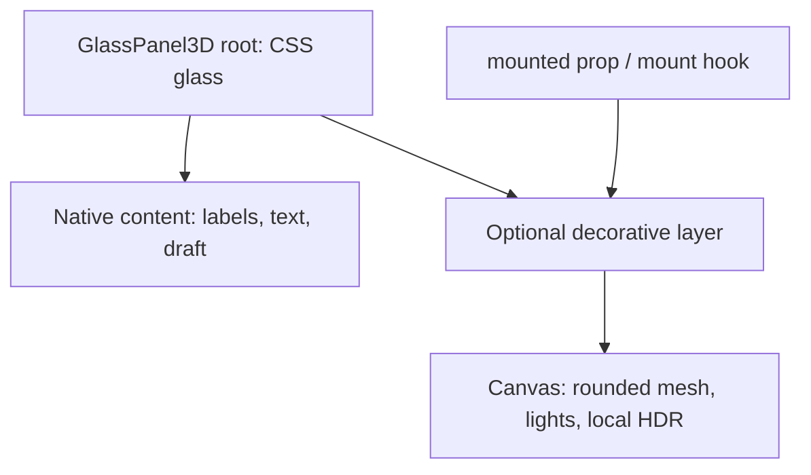

# Glass and panes: architecture and use

First Light has three related surface designs: native CSS panes, native content over a decorative Three.js panel, and an optional card whose native content follows a Three.js scene through Drei Html. They share styling and some rendering helpers, while keeping their DOM and lifecycle responsibilities explicit.

This guide describes the current source. It does not claim a new browser test, performance result or deployment. Complete implementations are in the [source catalog](component-catalog.md); regenerate that catalog after source changes.

## Choose a surface

| Need | Use | Rendering and content |
| --- | --- | --- |
| A normal section, header, field or list item with shared glass styling | [PaneBackground](../src/components/panes/PaneBackground.tsx) | One native HTML element; no Canvas. |
| Readable HTML with a removable, lighted 3D glass layer behind it | [GlassPanel3D](../src/components/glass-panel-3d/GlassPanel3D.tsx) | Native children stay mounted above a decorative Canvas. |
| The application's simple temporary research draft | [ResearchDraftPanel](../src/components/glass-panel-3d/ResearchDraftPanel.tsx) | GlassPanel3D plus a controlled native textarea. |
| An example of native HTML spatially aligned with a 3D card | [HtmlGlassCard](../src/components/html-glass-card/HtmlGlassCard.tsx) | One persistent DOM host moves between a native fallback slot and a Drei Html slot. |
| A standalone demonstration with controls for the above designs | [GlassPanelExample](../src/components/glass-panel-3d/GlassPanelExample.tsx) | Optional example; not mounted by the main application. |

The current [App](../src/App.tsx) mounts ResearchDraftPanel inside `#glass-workspace`. The optional [example entry](../examples/glass-panel-3d/main.tsx) mounts GlassPanelExample, which also demonstrates HtmlGlassCard. These are separate entry paths.

## Responsibility map

| File | Responsibility |
| --- | --- |
| [styles/glass.css](../src/styles/glass.css) | Shared custom properties for tint, blur, border, radius, shadow and text colour. |
| [GlassySurface.module.css](../src/components/glass/GlassySurface.module.css) | Applies those properties through a reusable, low-specificity glass class. |
| [AppleGlass.module.css](../src/components/glass/AppleGlass.module.css) | Composes an optional SVG lens into the CSS backdrop-filter value. |
| [AppleGlassLens.tsx](../src/components/glass/AppleGlassLens.tsx) | Defines the local SVG displacement filter and exports its theme property. |
| [PaneBackground.module.css](../src/components/panes/PaneBackground.module.css) | Composes the shared glass class for the native element wrapper. |
| [GlassPanel3D.module.css](../src/components/glass-panel-3d/GlassPanel3D.module.css) | Local smoked-glass overrides and native/decorative layer positioning. |
| [GlassPanelCanvas.tsx](../src/components/glass-panel-3d/GlassPanelCanvas.tsx) | Static Three.js scene, responsive mesh, local environment and rendering readiness. |
| [GlassMaterial.tsx](../src/components/glass-panel-3d/GlassMaterial.tsx) | The Three.js physical material used by both 3D panel examples. |
| [useGlassPanelMount.ts](../src/components/glass-panel-3d/useGlassPanelMount.ts) | Controls whether the decorative panel layer is mounted. |
| [HtmlGlassCanvas.tsx](../src/components/html-glass-card/HtmlGlassCanvas.tsx) | Optional card scene, torus accent and Drei Html placement. |
| [HtmlGlassCardContent.tsx](../src/components/html-glass-card/HtmlGlassCardContent.tsx) | The optional card's real labels, content and controlled textarea. |
| [moveHtmlHost.ts](../src/components/html-glass-card/moveHtmlHost.ts) | Reparents that same DOM host, preserving focus/selection where supported. |
| [useHtmlSceneActivity.ts](../src/components/html-glass-card/useHtmlSceneActivity.ts) | Tracks viewport, page visibility, reduced motion and WebGL capability. |

## Shared CSS values

The following are the current defaults in `src/styles/glass.css`:

| Property | Value |
| --- | --- |
| `--workspace-glass-background` | `rgba(35, 37, 49, 0.5)` |
| `--workspace-glass-blur` | `blur(7px)` |
| `--workspace-panel-border` | `1px solid rgba(240, 248, 255, 0.12)` |
| `--workspace-panel-radius` | `6px` |
| `--workspace-glass-colour` | `rgba(240, 248, 255, 0.88)` |
| `--workspace-glass-shadow` | `inset 0 0 0 1000px rgba(35, 37, 49, 0.015), 0 18px 45px rgba(0, 0, 0, 0.28)` |

GlassySurface applies `box-sizing:border-box`, those background/border/radius/shadow/colour values, `background-image:none`, inherited font family, and the selected backdrop filter. It supplies both the standard and WebKit-prefixed backdrop-filter declarations.

Its defaults use `:where(.glass)`, whose specificity is zero. A caller's own class or inline styles can therefore override a surface property. The table is the shared starting point, not a promise that every styled field in the application computes the same border or radius.

### Composition and inheritance are different

CSS module `composes` attaches the shared class names to the same element. PaneBackground's `.background` composes GlassySurface's `.glass`, which composes `.appleGlass`. This reuses declarations without adding a wrapper element.

Custom properties such as `--workspace-panel-radius` inherit down the DOM tree unless overridden. A pane nested beneath a theme container can use that container's token values. A local token override on GlassPanel3D similarly becomes available to its descendants.

Ordinary `background-color`, `border`, `border-radius`, `box-shadow` and `backdrop-filter` do not inherit automatically. A plain child div does not acquire its parent's glass box. It needs the composed class, PaneBackground, or its own declaration. Text colour and font inheritance follow their normal CSS rules.

An explicit `border-radius:inherit` on a decorative layer is a separate instruction: it copies the parent's computed radius. It does not make every descendant rounded.

Nested translucent surfaces also compound their tint. Two half-opacity layers do not have the same appearance as one isolated half-opacity layer. Ancestor filters and compositing boundaries can change what a nested backdrop filter samples; inspect the actual browser result when changing the layer hierarchy.

Blur needs visible variation behind the pane: shapes, text or colour boundaries. Blurring a uniform dark backdrop can look unchanged even when the filter works. An opaque ancestor/backing can hide the content behind a child pane; increasing the child's blur cannot recover imagery already covered by that backing.

For a per-pane theme change, pass a scoped CSS module class through `className` and declare custom properties in that class. That keeps the override local and avoids an untyped JavaScript object containing custom-property keys.

### The Apple-style lens

[main.tsx](../src/main.tsx) mounts AppleGlassLens once and applies `appleGlassTheme` to `.app-content`. The theme exposes `--apple-glass-lens`, pointing to the local `#gls-liquid-glass-tab-bar-lens` SVG filter.

The filter uses an embedded SVG gradient displacement map and `feDisplacementMap` with scale `20`, red as the x channel and green as the y channel. The reference HTML remains in [appleGlassBoilerplate.html](../src/components/glass/appleGlassBoilerplate.html).

This is a local adaptation of the supplied Apple-style HTML/SVG reference. It is not an official Apple SDK or an implementation supplied by Apple. The source reference did not include a companion stylesheet, so the reusable CSS composition is local application code.

AppleGlass starts with the ordinary workspace blur. An `@supports (backdrop-filter: url(...))` branch adds the lens URL before the blur when the browser accepts that syntax. A successful supports query does not prove that the displacement looks the same in every browser. Syntax support, SVG reference resolution and rendered compositing need visual verification on the target browser.

## Native PaneBackground

PaneBackground creates exactly the requested native element using React `createElement`. Supported `as` values are `div`, `section`, `aside`, `li`, `header`, `input`, `textarea` and `select`.

It forwards native props, handlers, labels/data attributes and refs, merges/deduplicates class names, and imports the shared glass tokens. It does not create a WebGL scene or wrap inputs in a second DOM element.

```tsx
import PaneBackground from './components/panes/PaneBackground'

<PaneBackground as="section" aria-labelledby="source-pane-title">
  <h2 id="source-pane-title">Research source</h2>
  <label htmlFor="source-note">Source note</label>
  <PaneBackground
    as="input"
    id="source-note"
    name="sourceNote"
    defaultValue=""
  />
</PaneBackground>
```

The section supplies grouping semantics; the input remains an ordinary editable input. Labels, keyboard behavior and form submission are the caller's responsibility, just as with native HTML.

Use the exported `paneBackgroundClassName` when an existing component must apply the same surface class to its own element. Avoid adding a duplicate glass wrapper solely to obtain the style.

## GlassPanel3D: two layers, one native content tree

GlassPanel3D accepts normal div props plus `mounted` and `contentClassName`. Its root composes the shared glass surface and always renders a native content div with the same key and position in the React tree.

When `mounted` is true, a sibling decorative layer loads GlassPanelCanvas lazily. The visual layer is absolute, `z-index:0`, clipped to the inherited radius, pointer-inert and `aria-hidden`. Its opacity is `0.16`. The native content is positioned at `z-index:1` and stays fully opaque.



The local CSS changes only the panel's tint, blur and shadow tokens:

| Local override | Value |
| --- | --- |
| Background | `rgba(44, 45, 49, 0.44)` |
| Blur | `blur(18px) saturate(1.15)` |
| Shadow | `inset 0 1px 0 rgba(255, 255, 255, 0.09), inset 0 -1px 0 rgba(255, 255, 255, 0.025), 0 18px 45px rgba(0, 0, 0, 0.32)` |

The root also adds a faint 135-degree white-to-transparent highlight gradient. It retains the shared border/radius/colour defaults unless the caller supplies another override. Its height follows native content, with an `8rem` minimum and responsive padding.

ResearchDraftPanel's textarea has its own `rgba(18,20,29,0.25)` background and explicitly uses the border/radius tokens. It is native HTML rather than a texture or Three.js object. Its controlled draft is session-only React state and clears on reload.

### The decorative scene

GlassPanelCanvas uses an orthographic camera with zoom `100`, a transparent antialiased renderer, DPR bounded from `1` to `1.5`, and `frameloop="demand"`.

The rounded box is sized from the canvas's width/height, leaving a two-pixel total margin. Its geometry depth is `0.16`; rounding is bounded by `0.06` world units and the panel dimensions. Ambient light has intensity `0.3`; directional light at `[2,3,5]` has intensity `1.5`.

The scene reads `potsdamer_platz_1k.hdr` from `${import.meta.env.BASE_URL}environments/potsdamer_platz_1k.hdr`. It uses a local file, not a remote environment preset. `useEnvironment` shares loader-cache data; passing the resulting texture through Environment's `map` form lets the scene restore its environment without disposing that shared texture.

Readiness is reported after the actual panel draw and after the local environment is attached. A missing WebGL capability, lazy-load error or context loss marks the decorative layer unavailable. Native content and CSS glass remain usable.

The initial capability check is constructor presence, not a successful GPU-context test. Context creation and asset loading can still fail, which is why the renderer boundary and unavailable path remain necessary.

### What the material contributes

GlassMaterial returns Three's `meshPhysicalMaterial` with these values:

| Setting | Value |
| --- | --- |
| Colour | `#cdd2d9` |
| Transmission / roughness | `0.95` / `0.2` |
| Optical thickness / index of refraction | `0.4` / `1.45` |
| Environment intensity / metalness | `0.4` / `0` |
| Clearcoat / clearcoat roughness | `0.75` / `0.18` |

Transmission refracts Three.js scene pixels. It does not turn native HTML behind the canvas into a refracted GPU texture. Separate WebGL canvases also do not automatically share their rendered pixels. The page's DOM/star-background compositing and CSS backdrop blur provide the browser-side glass appearance; the mesh contributes its own lighted surface.

Material transmission, mesh geometry depth and CSS opacity are different controls. Applying opacity to the entire panel would fade its labels and inputs too; the implementation instead fades only the decorative scene.

## Mount and unmount the GPU layer

`useGlassPanelMount(initialMounted = true)` returns `isMounted`, `mount`, `unmount` and `toggle`. It controls a boolean; it does not own the panel's draft or move the native content tree.

```tsx
import { useId, useState } from 'react'
import GlassPanel3D from './components/glass-panel-3d/GlassPanel3D'
import { useGlassPanelMount } from './components/glass-panel-3d/useGlassPanelMount'

export function ToggleableDraft() {
  const titleId = useId()
  const [draft, setDraft] = useState('')
  const { isMounted, toggle } = useGlassPanelMount()

  return (
    <>
      <button type="button" onClick={toggle} aria-pressed={isMounted}>
        {isMounted ? 'Unmount 3D glass' : 'Mount 3D glass'}
      </button>
      <GlassPanel3D mounted={isMounted} aria-labelledby={titleId}>
        <h2 id={titleId}>Research draft</h2>
        <label>
          Note
          <textarea value={draft} onChange={event => setDraft(event.target.value)} />
        </label>
      </GlassPanel3D>
    </>
  )
}
```

Passing `mounted={false}` removes only MountedGlassLayer. The native children remain mounted, retaining their values and node identity. Turning it back on creates a fresh decorative-layer readiness/error state. A failed layer has no automatic retry loop; an explicit unmount/remount provides a fresh attempt.

Keep GlassPanel3D and its children mounted while changing that prop. Conditionally removing the whole panel or changing its React key removes the native subtree as well and can reset local draft state.

GlassPanel3D has no automatic offscreen mount controller. Demand rendering avoids a continuous animation loop, while the application or mount hook decides when to release its Canvas entirely.

## Optional HtmlGlassCard: HTML follows a scene

HtmlGlassCard creates one persistent DOM host and one React portal for HtmlGlassCardContent. The content initially lives in the native fallback slot. After a visible/page-visible/WebGL-capable request, its lazy Canvas supplies a Drei Html slot and moves the same host into that slot.

Drei Html positions a DOM overlay in relation to the 3D camera. The current scene uses `center`, `transform`, `occlude`, position `[0,0,0.2]`, a portal target outside the canvas element and native pointer events. Occlusion is scene/raycast visibility behavior; the textarea is still browser HTML, not pixels rasterized into a Three.js texture.

The canvas renders the rounded physical-glass mesh and a wobbling torus accent. The HTML portal remains a separate DOM layer with interactive host content. Canvas opacity is `0.22`, and the canvas itself is pointer-inert; native labels and textarea stay opaque and interactive.

`moveHtmlHost` uses connected-DOM `moveBefore` when available, falling back to `appendChild`. It restores focus without scrolling and preserves input/textarea selection where the browser APIs allow. Moving the existing host avoids creating a second textarea or a second copy of the controlled value.

On renderer failure/context loss, the same host returns to the native slot. HtmlGlassCard keeps its controlled note state. HtmlGlassCardContent measures itself with offset dimensions/ResizeObserver, and the scene adapts its dimensions to that HTML size.

Animation runs only after readiness while visible, page-visible, not reduced-motion and not focused. Otherwise the Canvas uses demand frames and wobble is disabled. After its first request, the scene stays mounted while offscreen; inactivity pauses motion rather than automatically disposing the context.

The optional content uses ModalInputContainer and ThreeDHeading; the heading can mount its own FooterTextScene. This example can therefore involve more GPU layers than the simple native pane or GlassPanel3D design. Its input/error preview is a demonstration, not authentication or backend validation.

## Practical limits and review points

- Preserve native labels, focus outlines and contrast when changing tint or decorative opacity. A visual glass effect does not establish accessibility compliance by itself.
- Keep decorative layers pointer-inert and hidden from assistive technology. Expose meaningful content through the native DOM.
- Use shared custom properties for theme changes, then inspect caller overrides and nested composition. Changing one token does not remove a more specific field rule.
- Keep model/material transmission expectations within the Three.js scene. Use CSS for live DOM backdrop blur.
- Verify the local HDR request under the configured Vite base path; asset, lazy-chunk and context failures should leave native content usable.
- Test keyboard editing, focus/selection through HTML-host fallback, natural-height changes and GPU-layer toggling on the intended browsers.
- Check actual lens/filter appearance across target engines. CSS feature-query acceptance is not a visual result.
- Bound the number of simultaneously mounted GPU panels. Demand scheduling reduces repeated draws but retains contexts until unmount.

This guide is an implementation outline. It adds no component behavior, does not modify the shared theme, and makes no new runtime or deployment claim.
